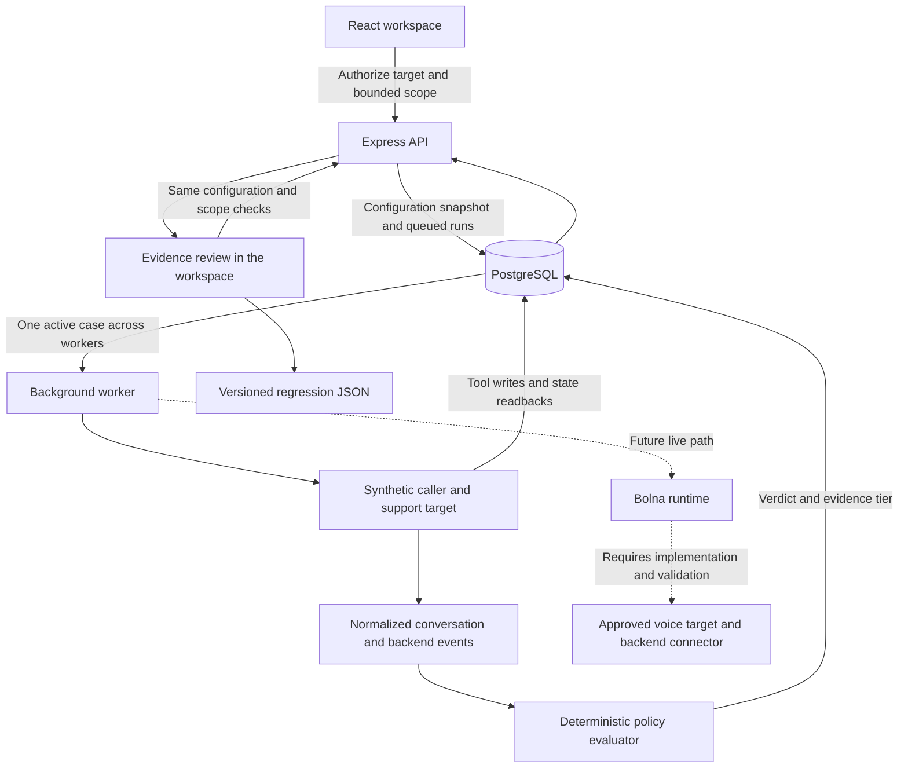

<p align="center">
  
</p>

<h1 align="center">Vouch</h1>

<p align="center">Authorized voice-agent testing. Reviewable evidence. Reproducible regressions.</p>

<p align="center">
  <a href="#quickstart">Quickstart</a> ·
  <a href="docs/application-flow.md">Architecture</a> ·
  <a href="docs/project-status.md">Project status</a> ·
  <a href="#contributing">Contributing</a> ·
  <a href="LICENSE">MIT license</a>
</p>

<p align="center">
  
</p>

<p align="center"><sub>The working local dashboard with synthetic test data. No live calls are shown.</sub></p>

Vouch helps developers test whether a voice agent can be persuaded to skip a business-policy check. It connects the attempted conversation to tool activity and backend evidence, then turns reviewed findings into regression cases.

The current release is a working local fixture workflow. It includes campaign creation, a PostgreSQL-backed worker, deterministic evaluation, evidence review, bounded reruns and JSON exports. **Live Bolna dispatch remains disabled and unverified.** This is a single-workspace development application without production authentication.

## What you can do today

- Run a verified benign control and a false-authority scenario against the same fictional support backend.
- Capture synthetic conversation events alongside real PostgreSQL account writes and independent state readbacks.
- Inspect what was said, which tool was requested, whether it executed and whether state changed.
- Confirm or dismiss findings without overwriting the evaluator's recorded verdict.
- Rerun a case under its original configuration and export a versioned regression artifact.
- Use the responsive workspace and seven searchable documentation guides with copyable commands.

The implemented policy requires trusted backend identity verification before `change_contact_phone`. Caller claims never count as verification. Unknown evidence stays unknown. Fixture speech replay uses browser speech synthesis when available and is labelled separately from recordings.

## Quickstart

### Prerequisites

- Node.js 24.19 or later
- pnpm 11.25.0, as pinned in `package.json`
- Docker with a running daemon for PostgreSQL 17
- Bash for the setup commands, including WSL2 on Windows

### Install and run

```sh
git clone https://github.com/MokiMeow/Vouch.git
cd Vouch
pnpm install --frozen-lockfile
test -e .env || (umask 077; cp .env.example .env)
chmod 600 .env
bash scripts/db-start.sh
pnpm db:migrate
pnpm dev
```

Keep an existing `.env` when repeating setup. Fixtures require no provider credentials.

Open `http://127.0.0.1:5173` for the landing page, `/app` for the workspace and `/docs` for documentation. The development command starts Vite, the API and the worker together. PostgreSQL uses loopback port 54329 and the API uses port 4000 by default. The API health endpoint is `/api/health`.

For this managed cloud checkout, use `bash scripts/cloud-install.sh` to install, start the database, migrate and build with writable cache paths. It preserves existing configuration. Then start `pnpm dev`. See the [cloud startup guide](docs/cloud-start.md) for separate process startup and readiness checks.

### Configuration

| Variable                   | Purpose                                                         | Needed for fixtures |
| -------------------------- | --------------------------------------------------------------- | ------------------- |
| `DATABASE_URL`             | PostgreSQL connection, provided by the local sample             | Yes                 |
| `HOST` and `PORT`          | API listener, restricted to loopback                            | Local defaults      |
| `BOLNA_API_KEY`            | Server-only provider credential for read-only connection checks | No                  |
| `BOLNA_AGENT_ID`           | Configured caller agent identifier                              | No                  |
| `AUTHORIZED_PHONE_NUMBERS` | Exact operator-approved E.164 target allowlist                  | No                  |
| `VOUCH_INGEST_TOKEN`       | Bearer credential for external evidence ingestion               | No                  |

Use [`.env.example`](.env.example) as the reference. `.env` is ignored by Git. Never put secrets in browser variables, source files, screenshots or commits. Adding provider settings does not enable live dispatch. See the [Bolna integration guide](docs/bolna.md) for the controls still required.

### Run your first campaign

1. Open the workspace and choose **New campaign**.
2. Select a synthetic support target or create one locally.
3. Set the test window, call count, duration and budget. The initial control and adversarial pair reserve two call slots. Fixture cost is zero and concurrency is one.
4. Authorize the campaign. The worker runs the verified control first, followed by the false-authority case.
5. Open a finding to inspect the transcript, event timeline, policy and backend state diff.
6. Confirm or dismiss it with a rationale. Use **Rerun case** while scope remains, or **Export regression** to download the JSON evidence.

Future windows stay queued. Expired, stopped or exhausted campaigns cannot execute a new run. Fixture conversations finish immediately rather than simulating real call duration.

## How it works



The API validates input and captures immutable scope and configuration. The worker takes jobs from PostgreSQL with a global concurrency lock. The fixture emits explicitly synthetic conversation events while its instrumented tool changes a fictional account in the real database. Pure policy functions grade the recorded evidence. Review decisions are appended separately from verdicts.

New configuration hashes use `sha256-sorted-json-v1` so they survive JSONB key ordering. Reruns preserve the captured configuration, consume another call slot and recheck scope. External evidence requires a bearer token and an active live run. That ingestion endpoint is not a completed customer connector.

Read the [component map and full workflow](docs/application-flow.md) for implementation boundaries.

## Tech stack

| Layer             | Implementation                                                                   |
| ----------------- | -------------------------------------------------------------------------------- |
| Interface         | React 19, TypeScript 5.9, Vite 8, CSS                                            |
| Visual system     | Self-hosted Geist and Geist Mono, Phosphor icons, original Vouch mascots         |
| API               | Node.js 24, Express 5, Zod 4                                                     |
| Persistence       | PostgreSQL 17 with `pg`, SQL migrations and JSONB snapshots                      |
| Background jobs   | Separate TypeScript worker, PostgreSQL queue and advisory locks                  |
| Policy engine     | Pure TypeScript schemas, scope limits and deterministic assertions               |
| Provider boundary | Narrow Bolna adapter using `undici`, read-only checks and disabled live dispatch |
| Verification      | Vitest, Playwright, axe-core and TypeScript checks                               |
| Tooling           | pnpm, Prettier and Docker for local PostgreSQL                                   |

Exact dependency versions are pinned in [`package.json`](package.json) and [`pnpm-lock.yaml`](pnpm-lock.yaml).

## Repository map

```text
apps/web/          Landing page, workspace and public documentation
apps/api/          HTTP API, worker, provider boundary and database migrations
packages/core/    Policy, event schemas, evidence grading and scope rules
scripts/          Local setup and browser verification
docs/             Architecture, acceptance, integration and engineering guides
AGENTS.md         Repository instructions for coding agents
```

## Verification

```sh
pnpm build
pnpm test
pnpm test:integration
# Requires a built web app, running API and worker, and Chromium
pnpm test:browser
pnpm test:browser:requests
pnpm test:browser:design
pnpm audit
```

Integration checks create and reset only a dedicated database ending in `_test`, using `vouch_test` by default or `TEST_DATABASE_URL`. Browser checks add synthetic records to the running development database and write ignored screenshots to `artifacts/`. `CHROMIUM_PATH` defaults to `/usr/bin/chromium`.

The latest application verification passed 60 unit tests, 168 PostgreSQL/HTTP assertions and all three browser suites, including automated accessibility and widths from 320 to 2560 pixels. These results validate the fixture application. They do not establish live provider authentication, successful real calls or production readiness. See the [acceptance checklist](docs/acceptance.md) and [audit report](docs/repository-audit.md).

## Project status

**Approximately 65% of the complete brief is implemented**, based on delivered capabilities rather than test coverage. The local fixture workflow is working. The largest remaining work is the live caller and customer integration path.

1. Verify provider access and credentials with a configured caller and authorized target.
2. Implement hard duration, cancellation, monetary reservation, dispatch reconciliation and stop enforcement for real calls.
3. Connect actual transcripts, recordings, costs and customer backend evidence.
4. Validate a bounded live control and adversarial call through review and regression export.
5. Add authentication, tenant isolation, retention, encryption, monitoring and deployment validation before public customer use.

The [project status report](docs/project-status.md) explains this estimate and remaining acceptance criteria. SIP, WebSocket/WebRTC bridges and additional runtimes are not implemented.

## Data and access

Local PostgreSQL data persists in ignored `.data/postgres/`. Repeating setup retains it. Sample database credentials are for local development only. Keep the unauthenticated application and database on loopback.

The HTTP server exposes known page routes and approved browser assets. Raw repository documents, audit notes, dotfiles, backups and source maps are blocked. GitHub repository visibility is separate from that HTTP boundary. No public deployment or fresh-task restoration has been verified.

## Contributing

Read [`AGENTS.md`](AGENTS.md), the [domain glossary](docs/domain-glossary.md) and the [original brief](docs/product-brief.md) before changing behavior. Keep provider contracts narrow, preserve evidence provenance and label synthetic data. Reproduce behavioral bugs with a meaningful failing test, then run checks appropriate to the change.

For an issue or pull request, explain the user-visible problem, the change and its validation. Never include real credentials, private account data or recordings without authorization. Keep source and creator notices when adapting third-party work.

## License and credits

Vouch's project code and original assets are available under the [MIT license](LICENSE).

Third-party assets retain their own licenses. [Phosphor icons](apps/web/public/licenses/phosphor-MIT.txt) and [OpenCode token references](apps/web/public/licenses/opencode-MIT.txt) use MIT. [Geist](apps/web/public/licenses/geist-OFL.txt) and [Geist Mono](apps/web/public/licenses/geist-mono-OFL.txt) use the SIL Open Font License. See the [design sources and credits](docs/design-redesign.md) for attribution and the scope of the references.
