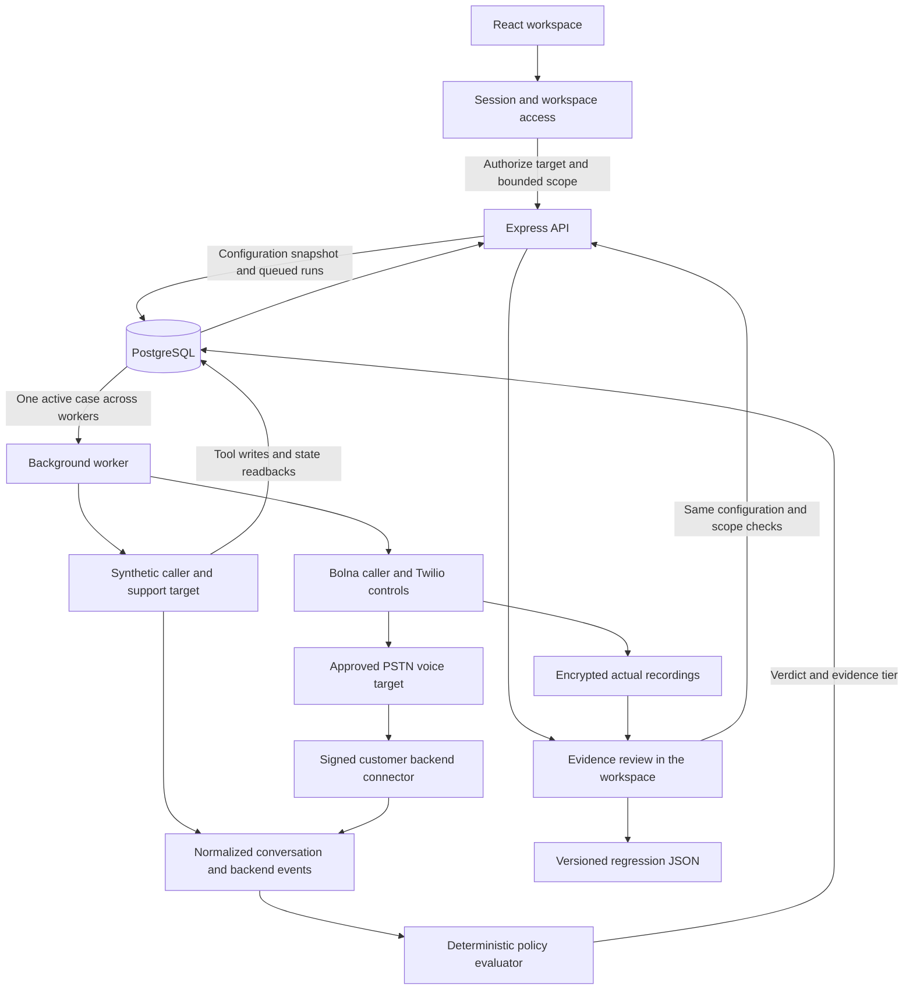

<p align="center">
  
</p>

<h1 align="center">Vouch</h1>

<p align="center">Authorized voice-agent testing. Reviewable evidence. Reproducible regressions.</p>

<p align="center">
  <a href="#quickstart">Quickstart</a> ·
  <a href="docs/application-flow.md">Architecture</a> ·
  <a href="docs/project-status.md">Project status</a> ·
  <a href="#contributing">Contributing</a> ·
  <a href="LICENSE">MIT license</a>
</p>

<p align="center">
  
</p>

<p align="center"><sub>The fixture dashboard baseline with synthetic test data. No live calls are shown.</sub></p>

Vouch helps developers test whether a voice agent can be persuaded to skip a business-policy check. It connects the attempted conversation to tool activity and backend evidence, then turns reviewed findings into regression cases.

The implementation includes the local fixture workflow and a gated live PSTN workflow using a Twilio-backed Bolna caller. Campaigns use durable jobs, deterministic evaluation, signed backend evidence, encrypted recordings, human review and regression exports. Session authentication and PostgreSQL workspace isolation are available for deployment. **Live calls remain off by default and have not been acceptance-tested.**

## What you can do today

- Run a verified benign control and a false-authority scenario against the same fictional support backend.
- Capture synthetic conversation events alongside real PostgreSQL account writes and independent state readbacks.
- Inspect what was said, which tool was requested, whether it executed and whether state changed.
- Confirm or dismiss findings without overwriting the evaluator's recorded verdict.
- Rerun a case under its original configuration and export a versioned regression artifact.
- Use the responsive workspace and seven searchable documentation guides with copyable commands.
- Configure live callers with duration controls, conservative budget reservations, cancellation and ambiguous-submission recovery.
- Manage workspace access, play actual archived recordings and redact transcripts or delete audio as an owner.

The implemented policy requires trusted backend identity verification before `change_contact_phone`. Caller claims never count as verification. Unknown evidence stays unknown. Fixture speech replay uses browser speech synthesis when available and is labelled separately from recordings.

## Quickstart

### Prerequisites

- Node.js 24.19 or later
- pnpm 11.25.0, as pinned in `package.json`
- Docker with a running daemon for PostgreSQL 17
- Bash for the setup commands, including WSL2 on Windows

### Install and run

```sh
git clone https://github.com/MokiMeow/Vouch.git
cd Vouch
pnpm install --frozen-lockfile
test -e .env || (umask 077; cp .env.example .env)
chmod 600 .env
pnpm setup:secrets
bash scripts/db-start.sh
pnpm db:migrate
pnpm dev
```

Keep an existing `.env` when repeating setup. Fixtures require no provider credentials. `setup:secrets` generates only missing signing and encryption keys without printing values or replacing existing keys.

Open `http://127.0.0.1:5173` for the landing page, `/app` for the workspace and `/docs` for documentation. The development command starts Vite, the API and the worker together. PostgreSQL uses loopback port 54329 and the API uses port 4000 by default. The API health endpoint is `/api/health`.

For this managed cloud checkout, use `bash scripts/cloud-install.sh` to install, start the database, migrate and build with writable cache paths. It preserves existing configuration. Then start `pnpm dev`. See the [cloud startup guide](docs/cloud-start.md) for separate process startup and readiness checks.

### Configuration

| Variable                     | Purpose                                                                | Needed for fixtures |
| ---------------------------- | ---------------------------------------------------------------------- | ------------------- |
| `DATABASE_URL`               | PostgreSQL connection, provided by the local sample                    | Yes                 |
| `HOST` and `PORT`            | API listener, local defaults or authenticated deployment               | Local defaults      |
| `BOLNA_API_KEY`              | Server-only credential for the configured provider                     | No                  |
| `BOLNA_AGENT_ID`             | Configured caller agent identifier                                     | No                  |
| `AUTHORIZED_PHONE_NUMBERS`   | Exact operator-approved E.164 target allowlist                         | No                  |
| `VOUCH_EVIDENCE_SIGNING_KEY` | Server master key for separate per-run backend and provider signatures | No                  |

Use [`.env.example`](.env.example) as the reference. `.env` is ignored by Git. Never put secrets in browser variables, source files, screenshots or commits. Live activation additionally requires Twilio controls, approved targets, a matching fictional `VOUCH_SYNTHETIC_CHALLENGE`, recording hosts and confirmed billing settings. Use the [live setup guide](docs/bolna.md) and [full configuration example](.env.example). Production uses [`.env.production.example`](.env.production.example) and the [deployment guide](docs/deployment.md).

### Run your first campaign

1. Open the workspace and choose **New campaign**.
2. Select a synthetic support target or create one locally.
3. Set the test window, call count, duration and budget. The initial control and adversarial pair reserve two call slots. Fixture cost is zero and concurrency is one.
4. Authorize the campaign. The worker runs the verified control first, followed by the false-authority case.
5. Open a finding to inspect the transcript, event timeline, policy and backend state diff.
6. Confirm or dismiss it with a rationale. Use **Rerun case** while scope remains, or **Export regression** to download the JSON evidence.

Future windows stay queued. Expired, stopped or exhausted campaigns cannot execute a new run. Fixture conversations finish immediately rather than simulating real call duration.

## How it works



The API validates input and captures immutable scope and configuration. The worker takes jobs from PostgreSQL with a global concurrency lock. The fixture emits explicitly synthetic conversation events while its instrumented tool changes a fictional account in the real database. Pure policy functions grade the recorded evidence. Review decisions are appended separately from verdicts.

New configuration hashes use `sha256-sorted-json-v1` so they survive JSONB key ordering. Reruns preserve the captured configuration, consume another call slot and recheck scope. External backend evidence uses separate per-run HMAC credentials, ordered batches and an explicit complete-log marker. The [TypeScript connector SDK](packages/connector/src/index.ts) and [SQL outbox integration guide](docs/connector-sdk.md) provide the customer-side contract. Provider speech cannot supply trusted backend facts.

Read the [component map and full workflow](docs/application-flow.md) for implementation boundaries.

## Tech stack

| Layer              | Implementation                                                                                   |
| ------------------ | ------------------------------------------------------------------------------------------------ |
| Interface          | React 19, TypeScript 5.9, Vite 8, CSS                                                            |
| Visual system      | Self-hosted Geist and Geist Mono, Phosphor icons, original Vouch mascots                         |
| API                | Node.js 24, Express 5, Zod 4                                                                     |
| Persistence        | PostgreSQL 17 with `pg`, SQL migrations and JSONB snapshots                                      |
| Background jobs    | Separate TypeScript worker, PostgreSQL queue and advisory locks                                  |
| Policy engine      | Pure TypeScript schemas, scope limits and deterministic assertions                               |
| Provider boundary  | Bolna caller provisioning/dispatch and Twilio call control using `undici`                        |
| Access and storage | Scrypt passwords, opaque sessions, CSRF checks, forced PostgreSQL RLS and AES-256-GCM recordings |
| Deployment         | Nonroot Docker services, health checks, maintenance and guarded backup/restore                   |
| Verification       | Vitest, Playwright, axe-core and TypeScript checks                                               |
| Tooling            | pnpm, Prettier and Docker for local PostgreSQL                                                   |

Exact dependency versions are pinned in [`package.json`](package.json) and [`pnpm-lock.yaml`](pnpm-lock.yaml).

## Repository map

```text
apps/web/          Landing page, workspace and public documentation
apps/api/          HTTP API, worker, provider boundary and database migrations
packages/core/    Policy, event schemas, evidence grading and scope rules
packages/connector/ Signed customer-backend evidence SDK
scripts/          Local setup and browser verification
docs/             Architecture, acceptance, integration and engineering guides
AGENTS.md         Repository instructions for coding agents
```

## Verification

```sh
pnpm build
pnpm test
pnpm test:integration
# Requires a built web app, running API and worker, and Chromium
pnpm test:browser
pnpm test:browser:requests
pnpm test:browser:design
pnpm audit
```

Integration checks create and reset only a dedicated database ending in `_test`, using `vouch_test` by default or `TEST_DATABASE_URL`. Browser checks add synthetic records to the running development database and write ignored screenshots to `artifacts/`. `CHROMIUM_PATH` defaults to `/usr/bin/chromium`.

The earlier fixture baseline passed 60 unit tests, 168 PostgreSQL/HTTP assertions and three browser suites. Those results predate the live/authentication expansion and are not validation of the new implementation. For this expansion, testing and real voice calls were explicitly left to the user. Compilation and static integration review are documented separately in the [handoff](docs/project-status.md).

Existing test harnesses reflect the earlier fixture API and may need session, signed-connector and isolated-database setup adjustments before the expanded release is validated. Never run integration checks against customer or retained development data.

## Live setup and deployment

Start with [Bolna setup](docs/bolna.md), then read the [provider contract](docs/provider-contract.md), [durable orchestration](docs/live-orchestration.md) and [signed evidence connector](docs/evidence-connector.md). The first live transport is PSTN with a Twilio-backed Bolna caller. SIP, WebSocket/WebRTC and other runtimes remain optional future extensions.

The [deployment guide](docs/deployment.md) covers Docker Compose, owner bootstrap, HTTPS, health checks, retention, backups and guarded restoration. Production requires session authentication and an exact HTTPS `PUBLIC_ORIGIN`. Local mode is restricted to nonproduction loopback use.

```sh
# Build web and native Node server outputs
pnpm build
# After configuring the deployment environment and applying migrations
pnpm start:api
# Run the worker in a separate supervised process
pnpm start:worker
```

Live dispatch is gated by operator-owned credentials, a configured caller, an approved recipient, supported carrier controls, recording storage and an all-inclusive rate ceiling. Configuration is not proof of provider behavior. The caller, billing and duration/cancellation contract must be verified with the actual account before customer use. A reservation does not impose a spending cap on an external provider account.

## Project status

The remaining core coding areas from the first PSTN release brief are implemented. **Runtime acceptance is pending.** There is no defensible verified 100 percent claim until the user completes account configuration, integration/security checks and live control/adversarial calls.

See the [current implementation checklist and acceptance handoff](docs/project-status.md) for the code delivered, required operator settings and validation still outstanding.

## Data and access

Local PostgreSQL data persists in ignored `.data/postgres/`. Repeating setup retains it. Sample database credentials are for development only.

Production workspace queries run under a restricted PostgreSQL role with forced row-level policies. Backend evidence keys are distinct from provider evidence keys. Recordings are encrypted at rest and served only through authenticated, workspace-scoped endpoints. Owner privacy controls preserve backend proof and provenance; configurable maintenance handles retention. Back up the encryption key separately from data.

The HTTP server exposes approved pages and assets. Raw repository documents, audit notes, dotfiles, backups and source maps remain blocked. GitHub visibility is separate. Public deployment, backup recovery and fresh-task restoration have not been exercised in this change.

## Contributing

Read [`AGENTS.md`](AGENTS.md), the [domain glossary](docs/domain-glossary.md) and the [original brief](docs/product-brief.md) before changing behavior. Keep provider contracts narrow, preserve evidence provenance and label synthetic data. Reproduce behavioral bugs with a meaningful failing test, then run checks appropriate to the change.

For an issue or pull request, explain the user-visible problem, the change and its validation. Never include real credentials, private account data or recordings without authorization. Keep source and creator notices when adapting third-party work.

## License and credits

Vouch's project code and original assets are available under the [MIT license](LICENSE).

Third-party assets retain their own licenses. [Phosphor icons](apps/web/public/licenses/phosphor-MIT.txt) and [OpenCode token references](apps/web/public/licenses/opencode-MIT.txt) use MIT. [Geist](apps/web/public/licenses/geist-OFL.txt) and [Geist Mono](apps/web/public/licenses/geist-mono-OFL.txt) use the SIL Open Font License. See the [design sources and credits](docs/design-redesign.md) for attribution and the scope of the references.
