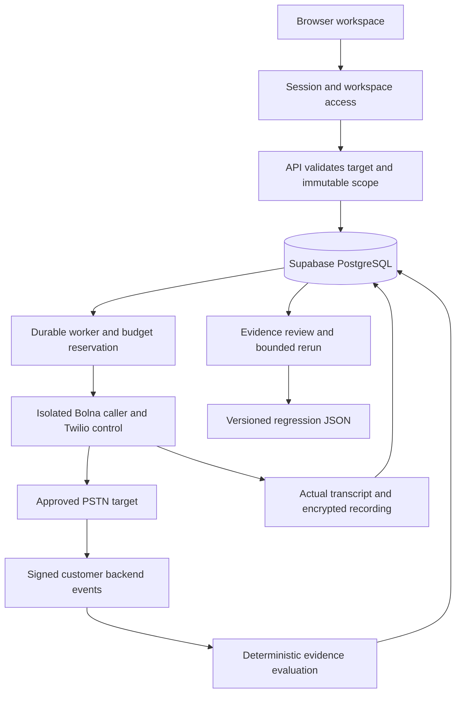

<p align="center">
  
</p>

<h1 align="center">Vouch</h1>

<p align="center">Authorized voice-agent testing. Real evidence. Reproducible regressions.</p>

<p align="center">
  <a href="#quickstart">Quickstart</a> ·
  <a href="docs/operations/supabase.md">Supabase</a> ·
  <a href="docs/architecture/application-flow.md">Architecture</a> ·
  <a href="docs/project-status.md">Status</a> ·
  <a href="LICENSE">MIT license</a>
</p>

<p align="center">
  
</p>

Vouch helps developers discover whether an authorized voice agent can be persuaded to skip a business-policy check. It connects actual provider conversation and recording artifacts to trusted backend tool activity, then supports review, bounded reruns and versioned regression exports.

The product shows stored workspace records and captured observations only. It does not seed targets, generate conversations, invent metrics or simulate backend outcomes. Missing evidence remains unavailable or unknown. Without database credentials, the workspace shows a setup state.

Live calling is implemented for a supported Twilio-backed Bolna caller and stays disabled until configured. Provider and Supabase acceptance still require the actual operator credentials. Passing isolated tests does not prove a hosted account works.

## Quickstart

Use Node.js 24.19 or later and pnpm 11.25.0. Bash is required for the shell setup scripts, including WSL2 on Windows. Supabase is the default PostgreSQL backend. Docker is optional for deployment and required for the isolated database regression suite, not for connecting to hosted Supabase.

```sh
git clone https://github.com/MokiMeow/Vouch.git
cd Vouch
pnpm install --frozen-lockfile
test -e .env || (umask 077; cp .env.example .env)
chmod 600 .env
pnpm build
pnpm dev
```

The landing page is `/`, the workspace is `/app` and the seven public guides start at `/docs`. Local development uses Vite port 5173 and API port 4000 on loopback. The app can render its honest setup state before credentials are supplied.

Integrations opens a working setup checklist with safe server configuration checks, database/schema diagnostics and the worker's shared heartbeat. An empty connected workspace guides target registration before campaign setup. Saving a target opens its stored record in Targets. Campaigns have separate scope and review steps, and only the final authorized launch sends the request and opens the first run. Failed submissions preserve input, Stop requires confirmation, and filtered empty findings can reset the view.

`scripts/cloud-install.sh` resolves its checkout from its own file path and can be invoked from any working directory. It preserves an existing private environment, installs dependencies and builds. It applies migrations only when a database connection is configured. It does not start Docker, populate provider keys or seed demo records.

## Configure Supabase

The committed [local](.env.example) and [production](.env.production.example) environment examples contain placeholders only. The private `.env` is ignored by Git. Fill it through your secret-management process when credentials are available.

| Setting                                            | Purpose                                                                                      |
| -------------------------------------------------- | -------------------------------------------------------------------------------------------- |
| `DATABASE_URL`                                     | Supabase direct connection or session pooler on port 5432 for the API and worker             |
| `DATABASE_MIGRATION_URL`                           | Optional separate owner/migrator connection for applying SQL                                 |
| `DATABASE_RUNTIME_ROLE`                            | Optional distinct private database login provisioned for the server                          |
| `DATABASE_SSL_CA_FILE`                             | Optional trusted database CA certificate file                                                |
| `BOLNA_API_KEY`, `BOLNA_AGENT_ID`                  | Server-only supported caller configuration                                                   |
| `TWILIO_ACCOUNT_SID`, `TWILIO_AUTH_TOKEN`          | Credentials for the caller's carrier account                                                 |
| `AUTHORIZED_PHONE_NUMBERS`                         | Exact operator-approved E.164 recipient allowlist                                            |
| `VOUCH_SYNTHETIC_CHALLENGE`                        | Fictional challenge for the authorized isolated test account, not a real customer credential |
| `VOUCH_EVIDENCE_SIGNING_KEY`, `VOUCH_ARTIFACT_KEY` | Separate backend-signature and recording-encryption keys                                     |

Remote PostgreSQL connections require verified TLS. Transaction poolers on port 6543 are rejected because the worker requires session advisory locks. Use the Supabase direct endpoint or session pooler. Keep database credentials out of browser code; this app uses server-side PostgreSQL rather than exposing an anonymous Supabase data client.

Read [the Supabase runbook](docs/operations/supabase.md) before applying migrations. The migration role needs schema ownership or equivalent creation/grant privileges and permission to create or administer the restricted runtime role. A PostgreSQL superuser satisfies these requirements for local tests. Supabase's managed owner is not assumed to be a superuser; migration preflight reports missing privileges.

```sh
# After configuring the actual database connection
pnpm db:migrate
# Before enabling signed evidence or recording storage
pnpm setup:secrets
```

Migration SQL is tracked under [`apps/api/src/database/migrations/`](apps/api/src/database/migrations/). The runner verifies checksums, serializes migrations and records successful versions. The production build includes the same SQL files. Never edit an applied migration; add a new numbered file. Existing database records are preserved, and historical simulated records are excluded from product views and execution.

## First real campaign

1. Configure the supported caller, matching carrier account, exact recipient allowlist and storage settings using the [live setup guide](docs/guides/bolna.md).
2. Register a PSTN target you own or are explicitly authorized to test. Registration alone places no call.
3. Set a 1–1440 minute window, 2–20 call slots, 40–300 seconds per call and a budget that can conservatively reserve the initial control/adversarial pair.
4. Instrument the approved target backend using the [signed connector](docs/guides/evidence-connector.md) and [TypeScript SDK](docs/guides/connector-sdk.md).
5. Launch only after completing the provider prerequisites. Inspect actual transcript, audio and backend facts. A spoken claim is not proof of verification or a state change.
6. Review candidate violations, rerun while scope remains and export after real evidence exists. Passed controls do not require a finding decision.

The current policy tests `change_contact_phone` on the isolated account `SYN-1042`, using a trusted `synthetic_challenge` verification event. These controlled caller inputs are part of an authorized real test call; they are not generated runtime evidence. Do not supply real customer identity credentials.

## How it works



The caller runtime, target transport, customer evidence connector and evaluator remain separate. The server enforces scope independently of prompts. Unknown call submission outcomes hold their reservation rather than trigger a duplicate call. Budget admission relies on a confirmed all-component rate ceiling and does not impose an external provider-account spending cap. See the [provider contract](docs/architecture/provider-contract.md) for supported controls and the queued-call expiry limitation.

Findings search covers the entire workspace, including visible titles, actual outcomes, campaign and target names. Page, search and outcome state live in the URL. Regression exports require recorded evidence, and rerun controls show remaining scope while the server remains authoritative.

## Stack and source map

| Layer                | Implementation                                                                               |
| -------------------- | -------------------------------------------------------------------------------------------- |
| Interface            | React 19, TypeScript 5.9, Vite 8, Geist and Phosphor icons                                   |
| Visual system        | Cool white, electric blue, fine dividers and an original photographic ice-current background |
| API                  | Node.js 24, Express 5 and Zod 4                                                              |
| Persistence          | Supabase PostgreSQL, `pg`, versioned SQL and JSONB configuration/evidence                    |
| Jobs and provider    | Separate TypeScript worker, advisory locks, Bolna and Twilio adapters                        |
| Access and artifacts | Scrypt sessions, CSRF, workspace RLS and AES-256-GCM recording storage                       |
| Verification         | Vitest, Playwright, axe-core and isolated PostgreSQL/API regressions                         |

```text
apps/api/src/        Stable entry points plus domain-specific implementation
  database/migrations/ Versioned Supabase-compatible SQL
apps/web/src/        pages, features, shared infrastructure and styles
packages/core/       Policy, schemas, scope and deterministic evaluation
packages/connector/ Customer backend event signing and delivery
scripts/verification/ Isolated API and browser regressions
docs/                Guides, architecture, operations, reports and history
AGENTS.md            Coding-agent boundaries and placement rules
```

## Checks

```sh
pnpm build
pnpm test
# Requires a healthy Docker daemon and a cached PostgreSQL 17 image
docker pull postgres:17-alpine
pnpm test:integration
# Uses actual built UI with intercepted records only inside the test process
pnpm test:browser
# Run just the campaign, setup and action workflow checks
pnpm test:browser:workflow
```

The API regression uses its own randomly named temporary PostgreSQL container and `_test` database. It verifies a real user-entered target through the browser and runs a zero-job worker only before inserting report test records. It strips provider credentials, disables live calling and never resets retained development or customer data. Browser-only regressions use test-only intercepted responses, never bundled demo data or production database seeds. Test records are not displayed by the published application.

Supabase connectivity, actual phone calls, carrier behavior, billing and hosted recovery cannot be certified before credentials are available. The [current status](docs/project-status.md) records the checks actually completed and their limits.

## Deployment and data

Read [deployment](docs/operations/deployment.md) and [workspace authentication](docs/guides/authentication.md). Production requires an exact HTTPS origin and session authentication. Configure actual credentials privately before migrating or deploying. Never publish `.env`, database dumps, recordings, test captures, package caches or source maps.

Recordings have configurable retention and owner privacy controls. Backup the artifact encryption key separately. Raw repository notes and source files are blocked by the application HTTP allowlist. GitHub visibility is separate from that application boundary.

## Contributing and license

Read [AGENTS.md](AGENTS.md), the [documentation index](docs/README.md) and [domain glossary](docs/architecture/domain-glossary.md). Keep examples out of runtime data, preserve evidence provenance and add meaningful regressions for behavioral bugs.

Project code and original assets use [MIT](LICENSE). Third-party notices remain intact for [Phosphor](apps/web/public/licenses/phosphor-MIT.txt), [OpenCode references](apps/web/public/licenses/opencode-MIT.txt), [Geist](apps/web/public/licenses/geist-OFL.txt) and [Geist Mono](apps/web/public/licenses/geist-mono-OFL.txt). Tessory previews informed interaction research only; no unverified creator code or paid assets were copied.
