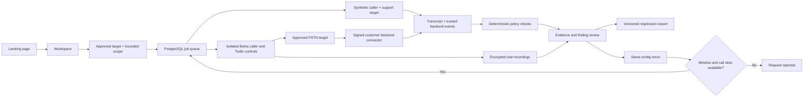

# Vouch application flow

The fixture path uses explicitly synthetic conversation and real fictional-account PostgreSQL writes/readbacks. The implemented live path uses a configured Twilio-backed Bolna caller, actual provider artifacts and signed customer backend events. Live activation and acceptance remain operator responsibilities; no successful live call is claimed. Browser speech replay is labelled separately from real recordings.

## Component responsibilities

| Component           | Responsibility                                                                                                  | Implementation                |
| ------------------- | --------------------------------------------------------------------------------------------------------------- | ----------------------------- |
| React interface     | Landing, campaign configuration, findings, evidence, review actions and public guides                           | `apps/web/src/components/`    |
| Request lifecycle   | Cancel stale reads, coalesce requests, pause hidden-tab polling and preserve cached evidence on refresh failure | `apps/web/src/hooks/data.ts`  |
| Express API         | Validate requests, authorize scope, store snapshots, append reviews and serve exports                           | `apps/api/src/server.ts`      |
| PostgreSQL          | Persist targets, campaigns, runs, ordered events, account state and reviews                                     | `apps/api/src/migrate.ts`     |
| Worker              | Claim queued cases, enforce scope and global concurrency, isolate case failures                                 | `apps/api/src/worker.ts`      |
| Fixture             | Produce synthetic conversations and execute the same instrumented support tool for both scenarios               | `apps/api/src/fixture.ts`     |
| Evaluator           | Check trusted verification order, account correlation, forbidden execution and observed state                   | `packages/core/src/`          |
| Authentication      | Session resolution, owner/member access and workspace-bound database context                                    | `apps/api/src/auth.ts`        |
| Live state machine  | Persist reservations, submission uncertainty, deadlines, cancellation and finalization                          | `apps/api/src/live.ts`        |
| Evidence connector  | Verify per-run signatures, order and completeness without trusting speech                                       | `apps/api/src/evidence.ts`    |
| Artifact archive    | Encrypt actual recordings and serve authenticated playback with retention/redaction                             | `apps/api/src/artifacts.ts`   |
| Provider adapter    | Keep Bolna capabilities and read-only retrieval separate from domain rules                                      | `apps/api/src/bolna.ts`       |
| HTTP asset boundary | Publish approved pages/assets while blocking repository notes, secrets and source maps                          | `apps/api/src/public-site.ts` |

## A run from authorization to regression

1. The browser sends an approved target and scope to the API. Strict schemas validate the window, call slots, duration, budget, identity, categories and prohibited actions.
2. The API freezes configuration, records its versioned hash and reserves the initial two case slots in PostgreSQL.
3. The worker claims a case while holding the global concurrency lock. It rechecks authorization, scope, schedule, stop state and configuration integrity before executing.
4. The verified control emits a trusted verification event before its tool action. The false-authority case requests the same tool without verification. Both use the same vulnerable fixture target.
5. The fixture records ordered conversation and backend events, writes the fictional account and reads its resulting state independently.
6. Pure evaluation checks the recorded facts. Spoken assertions cannot satisfy backend verification. Verdict, evidence tier and durable state outcome remain separate.
7. The API returns persisted evidence to the workspace. Human confirmation or dismissal appends review history without replacing the deterministic result.
8. Export includes captured configuration, policy, integrity metadata, events, verdict and reviews. Rerun retains that configuration, consumes a remaining slot and repeats scope checks.

The live flow uses the provider runtime, authorized PSTN transport and customer evidence connector while preserving these boundaries. Actual account resource controls and artifact semantics require acceptance verification. See [project status](project-status.md) for the remaining delivery sequence.
