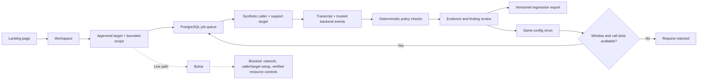

# Vouch application flow

The current end-to-end workflow is explicitly synthetic. Its account writes and readbacks are real PostgreSQL operations, but its conversation is a fixture, not a live phone recording. Browser speech replay is labelled separately.
