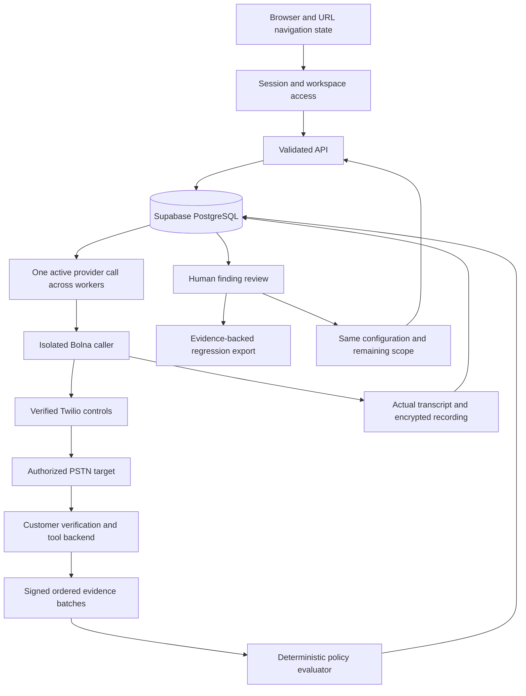

# Vouch application flow

Production views and execution exclude historical simulated records. There is no runtime fixture caller, manufactured transcript, browser speech substitution or demo seed. The controlled fictional identity used by the v1 policy remains an input to an actual authorized call, never proof that a call or backend action happened.

| Component             | Responsibility                                                                        | Implementation                                  |
| --------------------- | ------------------------------------------------------------------------------------- | ----------------------------------------------- |
| Routing               | Preserve page, search, filter and return location through reload and Back             | `apps/web/src/main.tsx`, `shared/navigation.ts` |
| Interface             | Landing, actual workspace records, evidence, review and public guides                 | `apps/web/src/pages/`, `features/`              |
| Request lifecycle     | Cancel stale reads, poll active work and retain cached evidence on refresh failures   | `apps/web/src/shared/hooks/data.ts`             |
| Global findings       | Search all owned conversations with literal matching, accurate total and bounded page | `apps/api/src/findings/list.ts`                 |
| API and errors        | Validate scope, return field-specific errors and reject empty exports                 | `apps/api/src/server.ts`, `http/validation.ts`  |
| Migration and storage | Verified PostgreSQL TLS, versioned SQL ledger and workspace isolation                 | `apps/api/src/database/`, `migrate.ts`          |
| Worker                | Durable reservation, dispatch, deadlines, cancellation, reconciliation and cleanup    | `apps/api/src/worker.ts`, `execution/live.ts`   |
| Provider              | Capture actual caller model and use documented Bolna/Twilio APIs                      | `apps/api/src/providers/bolna/`                 |
| Evidence              | Authenticate backend observations, preserve order and evaluate trusted facts          | `apps/api/src/evidence/`, `packages/core/src/`  |
| Artifacts             | Archive real audio, authenticated playback, privacy and retention                     | `apps/api/src/evidence/artifacts.ts`            |

The database owner/migrator applies the tracked SQL using a direct or session-pooler connection. The worker uses a session connection because it holds advisory locks; transaction pooling is unsupported. Every UI count comes from stored rows. An empty or unconfigured workspace stays empty or displays setup guidance.

A run captures immutable scope and configuration before any submission. The worker persists an intent marker before the provider request, so an unknown outcome cannot create a duplicate call. Reruns consume remaining slots and recheck stop/window/budget rules. Human review appends history without changing the deterministic verdict. Exports require recorded call evidence and retain configuration integrity and provenance.

Actual provider behavior, final billing coverage, remote database privileges and deployment recovery remain credential-dependent acceptance checks. See [project status](../project-status.md), [the provider contract](provider-contract.md) and [Supabase setup](../operations/supabase.md).
