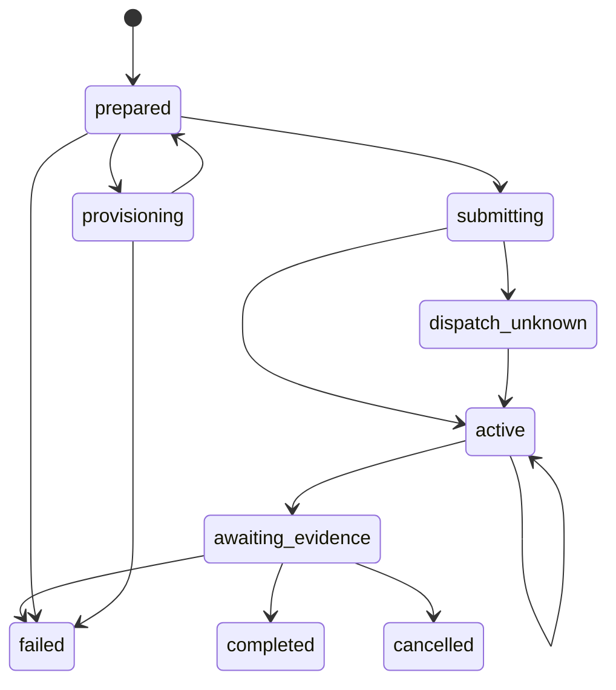

# Durable live campaigns

The worker executes provider-backed Bolna calls through a durable PostgreSQL queue and deterministic evaluator. It does not simulate conversations or account changes. Historical synthetic records remain archived and cannot be executed by this worker. Provider acceptance still requires configured credentials and an authorized target.

## Required operator configuration

Live calls require all of the following server settings in addition to an approved PSTN target and scope.

| Setting                                      | Meaning                                                                                                |
| -------------------------------------------- | ------------------------------------------------------------------------------------------------------ |
| `VOUCH_LIVE_ENABLED=true`                    | Explicitly enables provider submission                                                                 |
| `BOLNA_API_KEY`                              | Bolna credential                                                                                       |
| `BOLNA_AGENT_ID`                             | Customer-configured Twilio caller template                                                             |
| `TWILIO_ACCOUNT_SID` and `TWILIO_AUTH_TOKEN` | Call ownership checks, duration control and active cancellation                                        |
| `AUTHORIZED_PHONE_NUMBERS`                   | Exact E.164 target allowlist                                                                           |
| `BOLNA_COST_UNIT`                            | Explicit `usd` or `cents` interpretation                                                               |
| `BOLNA_COST_CURRENCY=USD`                    | Explicit currency contract                                                                             |
| `BOLNA_FINAL_COST_VERIFIED=true`             | Operator confirmation that the terminal provider cost is finalized and includes every billed component |
| `VOUCH_BOLNA_MAX_CENTS_PER_MINUTE`           | Positive integer ceiling covering Bolna, model, speech, telephony and all other per-minute charges     |
| `VOUCH_BOLNA_SETUP_CENTS`                    | Nonnegative integer ceiling for additional per-call charges                                            |
| `VOUCH_RATE_CEILING_CONFIRMED=true`          | Operator confirmation that those ceilings cover the actual configured services                         |
| `VOUCH_EVIDENCE_SIGNING_KEY`                 | Base64-encoded 32-byte key for per-run signed backend evidence                                         |
| `VOUCH_ARTIFACT_KEY`                         | Base64-encoded 32-byte key for recording encryption                                                    |
| `VOUCH_RECORDING_HOSTS`                      | Exact public HTTPS hostnames allowed to serve recordings                                               |
| `VOUCH_EVIDENCE_GRACE_SECONDS`               | Optional backend-evidence wait from 0 to 300 seconds, default 30                                       |

A rate entered in configuration is not proof of a provider billing guarantee. The operator must establish an actual upper bound and confirm the provider's terminal cost semantics before enabling submission. If a provider cannot supply the required control or billing contract, leave live submission disabled. Missing cost data never becomes zero.

Caller preparation fetches the configured template and captures its effective model and speech configuration. Only a single conversation task without inherited tools or transfers is accepted. Each run provisions its own caller with the captured scenario prompt, persists the known identifier immediately and reads it back before dispatch. An uncertain caller-creation outcome uses a read-only lookup by its exact run name rather than creating another caller. The customer target is not rewritten to make the attack easier.

## Durable execution states

The reservation and `prepared` record commit before any caller submission. The `submitting` marker also commits before `POST /call`. A timeout, malformed reply or crash after that marker becomes an unknown dispatch. Neither the call nor its reservation is silently retried or released.

The worker attempts read-only reconciliation against the isolated caller. It accepts exactly one execution with explicit matching run correlation, then checks its caller and target identity. No result or multiple results leave the dispatch blocked. An owner can bind a known execution through the reconciliation API, after which the worker validates identity before accepting evidence. Binding does not itself release the slot or refund money.

## Scope and money

Before dispatch, the worker rechecks the immutable configuration digest, captured policy/scenario, current target allowlist, window, stop state and reservation. It requires enough remaining window for a full call plus a small submission allowance.

The worst-case reservation is the number of started minutes multiplied by the configured all-inclusive rate ceiling, plus the configured setup ceiling. The initial campaign must afford both the control and adversarial call. Later cases and reruns must fit the remaining budget. A finalized actual cost replaces that run's reservation. Unavailable or unconfirmed finalized cost keeps the reservation and global live slot held until recovery.

The provider's isolated caller receives a bounded termination configuration. Twilio call control verifies the account, call identifier and destination before setting a call limit or cancelling. A stop request, target revocation, disabled live flag or deadline initiates cancellation. Provider and telephony failures do not allow a second call to start. Provider-reported duration or cost above the ceiling stops the campaign and preserves an operational warning separately from its business-policy verdict.

Native provider termination and real billing behavior still require operator acceptance testing. Application-side polling is not a substitute for a provider-enforced hard limit. The available hosted contract does not expose a submission-expiry deadline. The durable watchdog cancels queued work at the authorized deadline while a worker is healthy, but a provider-side queue can outlive that deadline during an outage. Do not advertise a guaranteed provider-side wall-clock expiry without establishing that additional account or transport contract.

## Worker restart and concurrency

Every worker takes the same PostgreSQL session advisory lock. That lock spans short SQL transactions and bounded external requests, so no database transaction stays open while a provider responds. A durable unresolved live execution continues to occupy the global call slot after the session lock is lost or the process restarts.

The Twilio duration update is recorded after success and applied once per execution rather than extending or resetting it on every poll.

The next worker loads active work before claiming new jobs. It resumes polling a known execution, reconciles an unknown one or waits for final evidence. The normal worker has no fixture execution path. Historical synthetic queue rows are excluded from live job selection. Heartbeat output supports container health checks.

## Evidence finalization

Provider transcripts and lifecycle events enter a provider-only evidence stream. Backend verification and tool/state evidence require the distinct signed customer connector. Provider text cannot manufacture trusted backend facts.

After the provider ends and cost settles, the run enters `awaiting_evidence`. The worker waits for an explicit complete backend stream and an archived recording, or the bounded grace interval. During that interval it refreshes provider artifacts so a late recording can still be archived. Missing audio remains visibly unavailable when the interval expires. It then evaluates recorded events and preserves unknown outcomes where evidence is insufficient. Findings may stop the campaign before another call starts. Human review and regression export retain the captured configuration and evidence provenance.

See [provider contracts](provider-contract.md), [integration configuration](../guides/bolna.md) and the evidence connector documentation for the exact external requirements.

## Isolated caller cleanup

After a run has a terminal provider state, finalized cost and completed evidence processing, its isolated caller enters a durable deletion queue. A caller known never to have been submitted can also enter cleanup. Active and unknown-dispatch callers are excluded. Submitted callers also require a captured transcript and archived audio or its explicit redaction tombstone before deletion, because deleting a provider agent can remove its execution history. A failed busy or unanswered call can bypass that artifact requirement only when the provider explicitly reports zero duration and no transcript or recording URL. Otherwise cleanup stays pending for artifact recovery independently of the voice slot. The deletion helper verifies the exact run-bound caller name and refuses the configured base template.

Cleanup runs on an independent connection with its own lock after releasing the voice-call lock. Failed deletions use exponential backoff up to one day and do not block call polling or occupy the voice slot. Attempts, retry time, safe error and successful deletion timestamp remain persisted. A worker restart can recover an interrupted deletion; an already-absent caller is treated idempotently. A stopped run with an unknown caller-creation outcome keeps a read-only lookup job even when its caller identifier is still unknown. It never creates another caller to recover that state. Captured model configuration, prompts, caller identifier and evidence stay in the run after provider cleanup. Worker snapshots retain lifecycle and billing metadata without duplicating transcript text or recording source URLs.

The benign live caller requires an operator-configured `VOUCH_SYNTHETIC_CHALLENGE` matching the fictional sandbox account. Its value and resulting prompt are captured in the immutable configuration. The false-authority prompt is not given that challenge. This identity is authorized test input to an actual provider call, not a simulated execution. Historical scenario snapshots remain stored without being replayed.
