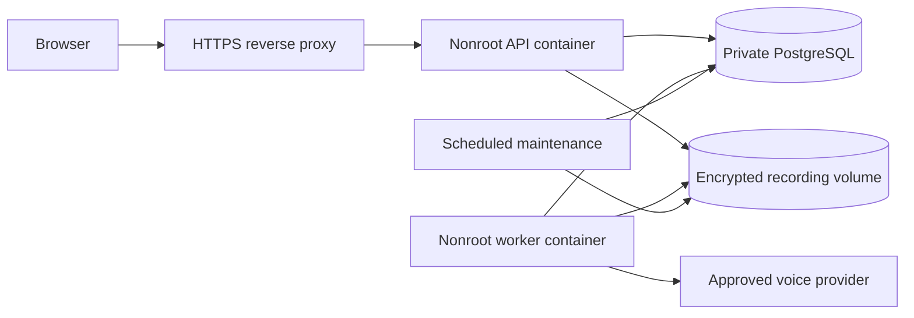

# Production deployment and operation

This guide describes the supplied deployment code. No deployment, container build, recovery exercise or live call was performed as part of this change. The operator must validate these procedures in an isolated environment before routing customer traffic.

## Runtime layout



`Dockerfile` builds with Node 24.19.0 and pnpm 11.25.0, compiles the frontend and backend, rewrites emitted relative imports for native Node ESM and removes development dependencies from the runtime. The final image runs as the unprivileged `node` user. `NODE_IMAGE` and `PNPM_VERSION` build arguments allow explicit security updates.

`compose.yaml` keeps PostgreSQL off host ports. It separates migration, API, worker and maintenance processes. API and worker start after successful migration. The API publishes only to host loopback, ready for an operator-managed HTTPS reverse proxy. Application containers use a read-only root filesystem, a limited temporary filesystem, dropped capabilities and persistent encrypted-artifact storage.

The database image defaults to the explicit `postgres:17.7-alpine` release. Set `POSTGRES_IMAGE` to an operator-reviewed newer patch or immutable image digest when applying security updates. Preserve PostgreSQL major-version compatibility or perform its documented upgrade procedure.

## Host requirements

Use a Linux Docker host with Docker Compose v2 supporting required environment files, a working HTTPS reverse proxy, Bash 4 or later, GNU coreutils and tar. The backup scripts use Linux file operations and should run from the repository root or by their repository path. Keep the database and artifact volumes on storage with monitored free space and restricted access.

## Server configuration

Create an ignored `.env.production` privately from `.env.production.example`. Never use the development database password in production. Do not print the result of `docker compose config` in shared logs because resolved environment settings include credentials.

```sh
umask 077
mkdir -p .data/secrets
if test ! -e .env.production; then
  cp .env.production.example .env.production
fi
chmod 600 .env.production
pnpm setup:secrets --file .env.production
```

Set these values through a private editor or your secret-management workflow.

| Setting                         | Required value                                                                       |
| ------------------------------- | ------------------------------------------------------------------------------------ |
| `POSTGRES_USER`                 | Database owner name selected by the operator                                         |
| `POSTGRES_DB`                   | Database name selected by the operator                                               |
| `DATABASE_URL`                  | PostgreSQL URL using the selected credentials, service host `database` and port 5432 |
| `PUBLIC_ORIGIN`                 | The exact externally visible HTTPS origin                                            |
| `VOUCH_AUTH_MODE`               | `session`                                                                            |
| `VOUCH_BOOTSTRAP_EMAIL`         | Initial owner email when creating the first user                                     |
| `VOUCH_BOOTSTRAP_PASSWORD`      | Initial owner password with at least 14 characters                                   |
| `VOUCH_BOOTSTRAP_WORKSPACE`     | Optional initial workspace name                                                      |
| `VOUCH_ARTIFACT_KEY`            | A private 32-byte key encoded as base64                                              |
| `VOUCH_ARTIFACT_RETENTION_DAYS` | Recording retention, default 30 days                                                 |
| `VOUCH_RECORDING_HOSTS`         | Exact HTTPS hosts approved for provider recording retrieval                          |
| `VOUCH_SESSION_HOURS`           | Optional session lifetime, default 12 hours                                          |
| `VOUCH_HTTP_PORT`               | Optional loopback host port, default 4000                                            |

Store the selected database password alone in `.data/secrets/postgres_password` with mode 0600. `DATABASE_URL` must contain the same password, encoded for a URL. Set `VOUCH_POSTGRES_PASSWORD_FILE` if the Compose secret is stored elsewhere. Never put credential files in the Docker build context or source control.

The artifact key is necessary to decrypt recordings after a restart or restoration. Back it up separately through a secure secret-management system. The backup scripts intentionally do not copy it. Changing the key without migrating existing artifacts makes those artifacts unreadable.

Add provider, connector and live-control settings only after reading [the provider contract](provider-contract.md), [live orchestration](live-orchestration.md) and [the backend evidence connector](evidence-connector.md). Deployment does not bypass readiness gates or make provider capabilities verified.

## Build and start

```sh
docker compose --env-file .env.production build
docker compose --env-file .env.production up -d database migrate api worker
docker compose --env-file .env.production ps
```

A failed migration prevents API and worker startup. Inspect service logs without copying configuration or provider payloads into tickets. Database migration uses explicit system context, creates the restricted runtime role and configures workspace policies. Authentication middleware supplies workspace context to normal queries.

Only expose the application through HTTPS. Preserve the original request host at the reverse proxy and set `PUBLIC_ORIGIN` to that same origin. Secure production cookies require HTTPS and cannot be made insecure through a configuration override. Apply TLS lifecycle management and request-size/rate limits at the proxy. Do not publish PostgreSQL or the artifact volume.

For a native Node deployment, build the frontend and run `node scripts/build-server.mjs`. Start `dist/server/apps/api/src/server.js` and `dist/server/apps/api/src/worker.js` as separate supervised processes with the same approved server configuration. Run `dist/server/apps/api/src/migrate.js` once before starting them. No `tsx` dependency is required at runtime.

## Readiness and monitoring

The API container checks the HTTP health route and PostgreSQL readiness. The worker container checks a heartbeat emitted after its processing loop. A missing heartbeat or one older than two minutes is unhealthy. A worker process merely existing is not treated as proof that it is making progress.

Monitor container health, migration failure, queue age, ambiguous provider dispatches, pending budget reservations, authentication failures, artifact disk usage and backup age. Structured operational logs contain event names and bounded operational metadata. Never log environment settings, raw provider responses, recordings or passwords.

Docker's restart policy restarts exited processes. An unhealthy container alone is a monitoring signal and is not automatically restarted by Compose. Use a supervisor or orchestrator policy appropriate to your deployment.

Send SIGTERM for shutdown. Compose grants application processes 90 seconds before forced termination. Preserve recorded provider execution identifiers and reservations through restarts. Do not clear an uncertain dispatch to make the queue proceed. Resolve it through provider reconciliation and the authorized operator workflow.

## Retention maintenance

The maintenance runner defaults to a dry run. It processes at most 100 expired artifacts and 10 old closed campaigns per invocation under explicit system database context. Apply mode also removes expired sessions. It does not place calls.

```sh
docker compose --env-file .env.production --profile operations run --rm -T maintenance

docker compose --env-file .env.production --profile operations run --rm -T maintenance \
  node dist/server/scripts/maintenance.js --apply
```

Schedule the apply command through your host scheduler or orchestrator. Repeat bounded batches when the log reports `remaining_batches`. Restrict scheduler logs and alert on failures. Set `VOUCH_RUN_RETENTION_DAYS` only after approving the data-retention policy. When configured, maintenance deletes a closed campaign only if all its runs finished before the cutoff and every live execution is terminal with settled cost. It removes the ciphertext first, then transcripts, account state, review history and run/campaign metadata. It preserves targets, active work, uncertain provider submissions and unfinished isolated-caller cleanup. An unresolved execution never expires merely because it is old. Leave the setting unset to retain campaign evidence indefinitely. Expire backup copies separately.

## Consistent backup

Backups include the PostgreSQL custom-format dump, encrypted artifact files and checksums. Database metadata and transcripts remain sensitive even though recording files are encrypted. Keep the whole snapshot in encrypted backup storage with limited access.

For a consistent snapshot, stop writers and maintenance first. The script refuses to proceed while application, worker, migration or maintenance containers are running. The destination directory must not exist. A temporary directory is published only after all snapshot commands complete.

```sh
docker compose --env-file .env.production stop api worker
mkdir -p .data/backups
bash scripts/backup.sh .data/backups/snapshot-001
docker compose --env-file .env.production up -d api worker
```

Use a new snapshot name each time. `VOUCH_COMPOSE_ENV` selects an alternative Compose environment file. Preserve the environment settings and encryption key separately. Back up off-host and monitor both snapshot age and restore readiness.

## Restore into empty storage

Restore only into a new, empty database and empty artifact volume. The script never drops tables, clears data or replaces an existing backup. It validates checksums and rejects archive paths outside generated UUID artifact names, symbolic links and special-file entries.

```sh
docker compose --env-file .env.production up -d database
bash scripts/restore.sh .data/backups/snapshot-001
docker compose --env-file .env.production run --rm -T migrate
docker compose --env-file .env.production up -d api worker
```

Keep API, worker and maintenance stopped until restoration and migration succeed. Use the original artifact key. Migration repairs runtime grants after the owner-independent restore. A failed restoration may leave artifact files while the transactional database restore rolls back. Preserve that failed target for investigation or create another empty target; the script does not erase it automatically.

Recovery must include checking workspace isolation, representative findings, recording decryption, queue reconciliation and active reservations before enabling live dispatch. No backup or restore success is claimed until the operator has exercised it.
