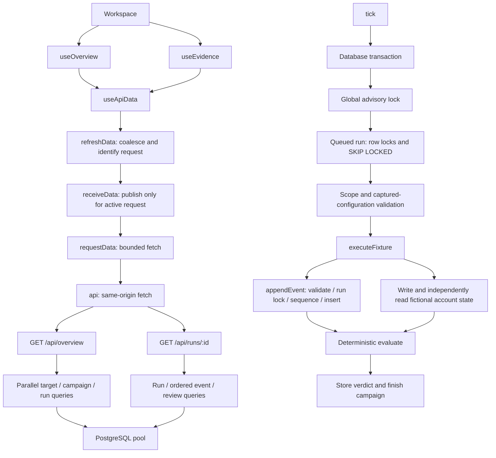

# Vouch performance and request-flow audit

Measured on 28 October 2026 in the managed development environment. This is a local development audit, not a production load test or service-level guarantee. All HTTP measurements are read-only; browser race fixtures are intercepted in Chromium and never persisted. No provider call was placed.

## Verified request paths



The fixture path deliberately uses one global active call, independently of how many worker processes run. Events use a run lock and a unique `(run_id, seq)` constraint. The worker's transaction and savepoint are correctness boundaries; removing them merely to reduce query counts would weaken evidence integrity.

## Measured findings and repairs

**A late evidence response could display the wrong run.** Reproduced by opening queued run A, delaying its timer refresh, navigating to completed run B, and then releasing A. The URL still identified B while the heading and evidence identified A. The regression test first failed on this exact behavior. The resource hook now aborts abandoned requests and checks both the active path and request-controller identity before changing state. A queued response from an earlier visit cannot win after navigating away and back.

**Active-run polling could overlap slow requests.** The previous detail timer called an unguarded refresh every 1.5 seconds. The shared resource now coalesces refreshes into one in-flight promise, bounds requests with a 15-second timeout, and pauses scheduled requests in hidden tabs. Returning to the page refreshes immediately. A regression holds one request across multiple timer ticks and verifies no additional request starts.

**A missing run remained on the loading screen.** Initial detail failures now produce an explicit error with retry and a route back to the workspace. The regression returns a real HTTP 404 through the mocked browser transport, then succeeds on retry and verifies recovery.

**Timeout and refresh recovery must preserve the evidence context.** A real 15-second stalled request now produces a retryable timeout instead of an endless spinner. A failed refresh keeps the last fetched evidence and the selected tab visible, with a warning. The timeout uses broadly supported `AbortController` methods; the regression removes `AbortSignal.any` and `AbortSignal.timeout` before loading the app and still passes. Mutation-triggered reloads wait for an older in-flight read before issuing a fresh read, while scheduled polling still coalesces concurrent requests.

**The overview transferred full captured configurations repeatedly.** Before projection, 17 campaigns, 49 runs and 12 targets produced a 164,748-byte JSON response. Thirty sequential loopback requests measured p50 **7.64ms**, p95 **14.91ms**, mean **11.01ms** and maximum **87.63ms**. Timing includes fetching, reading and parsing JSON. At a 2.5-second polling interval, that body alone is approximately **237MB per visible tab per hour**, before protocol overhead. An earlier sample showed that removing only redundant configuration properties reduced its body by about 61%. Raw aggregate measurements, without credential or record contents, are retained in ignored `artifacts/performance/overview-baseline.json`.

**Campaign rows repeatedly filtered the complete run list.** The original list did one `runs.filter` for every campaign, requiring `campaigns × runs` predicate checks. A controlled Node/V8 in-memory benchmark of the same predicate measured 20.39ms for 1,000 campaigns / 2,000 runs and 1,765.46ms for 10,000 / 20,000. Grouping once produced identical counts in 0.41ms and 4.81ms respectively. These are algorithm measurements, not browser render timings or persisted test data.

The repository's final changes project overview data and group campaign runs once. After projection, the same unchanged dataset produced a **55,932-byte response**, a **66.05% reduction**. The test explicitly checked that neither campaign nor run summaries contain a `config` property. At the same polling interval, the body is approximately **81MB per visible tab per hour**. The overview now polls every 2.5 seconds during queued/running work and every 30 seconds when idle; at the measured sample size, idle body traffic is approximately **6.7MB/hour**. These traffic figures are arithmetic projections from measured response sizes, not a production bandwidth test. Hidden tabs pause polling. The remaining growth with history is why pagination is still listed below.

| Read-only local measurement |        Before | After projection |
| --------------------------- | ------------: | ---------------: |
| Campaigns / runs / targets  |  17 / 49 / 12 |     17 / 49 / 12 |
| Response body               | 164,748 bytes |     55,932 bytes |
| Sample count                |            30 |               30 |
| p50                         |        7.64ms |           5.52ms |
| p95                         |       14.91ms |          10.96ms |
| Mean                        |       11.01ms |           8.47ms |
| Maximum                     |       87.63ms |          78.30ms |

After measurements are retained in ignored `artifacts/performance/overview-after.json`. The timing samples include loopback transport, reading and JSON parsing; cache state and shared-machine scheduling affect them. The measured size reduction is exact for this dataset. The latency observations do not establish a production throughput limit or a guaranteed speedup.

## Validation

With the built API running and system Chromium available:

```sh
pnpm test:browser:requests
```

The browser-only suite covers late-route responses, slow-request overlap, missing-run recovery, timeout recovery, cached evidence, browser compatibility, hidden-tab polling and foreground refresh. Its synthetic API records are not persisted. The main `pnpm test:browser` suite separately covers the actual campaign → worker → evidence → review → export workflow, responsive screens and automated accessibility.

## Remaining limits

- Overview history is not paginated. Projecting columns and grouping rows reduce waste, but response size and DOM size still grow with retained history. Large-workspace support needs server pagination plus separate aggregate counts; silently truncating lists would produce incorrect dashboard metrics.
- The fixture worker intentionally sleeps between queue checks. It is designed for bounded synthetic campaigns, not high-throughput live calling. No throughput claim is made for provider workflows.
- Provider-side duration, cancellation, cost reconciliation and live integration validation remain separate blockers. Local browser/API performance cannot prove those capabilities.
- The frontend is roughly 100KB gzipped JavaScript in the measured production build. No demonstrated bundle-size failure justified adding a larger loading or routing framework.
